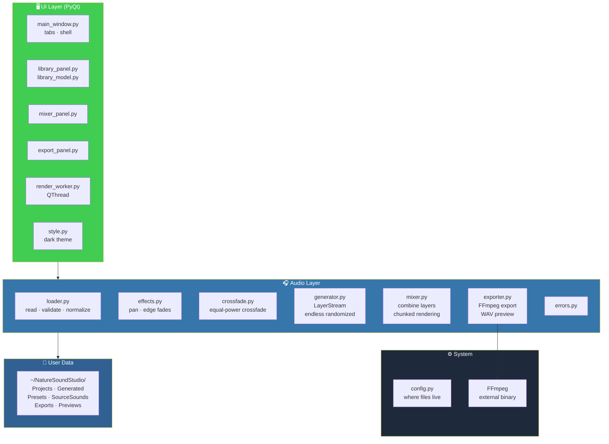
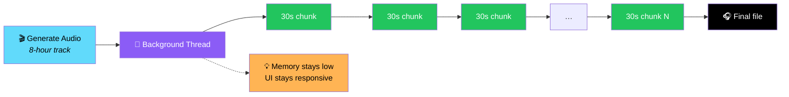

# 🎧 NatureSound Studio (Phase 1)

<div align="center">


**Create long-form ambient / nature soundtracks.**

*Rain · Ocean · Forest · Fireplace — with a mixer, seamless randomized looping, and MP3 / WAV / FLAC export*

[✨ Phase 1](#-phase-1-build) • [🏗️ Architecture](#️-architecture) • [🚀 Install](#1-install-python-dependencies) • [🎛️ Using It](#4-using-it) • [📦 Package as .exe](#5-package-as-a-windows-exe)

</div>

---

## 📖 Overview

**NatureSound Studio** lets you build long-form ambient soundscapes — rain on a window, ocean waves, a crackling fireplace — with a real mixer and seamless looping that never sounds like a loop.

### 🎯 Phase 1 Build

> **This is the Phase 1 build:**
>
> - ✅ **Sound library + import**
> - ✅ **Mixer with volume / pan / mute / solo**
> - ✅ **Seamless crossfaded looping**
> - ✅ **MP3 / WAV / FLAC export**

**Not in this build yet** *(Phase 2 / Phase 3)*:

- ❌ Built-in procedural sound generators
- ❌ Auto Mix
- ❌ YouTube / video tools

> ⚠️ **Only use audio you have permission to use.**
>
> **This app does not download audio for you** — bring your own recordings, public-domain sounds, or properly licensed sound effects.

---

## ✨ Features

<div align="center">

| 📚 Sound Library | 🎛️ Real Mixer |
|:---:|:---:|
| Import WAV/MP3/FLAC · tag with categories (Rain, Ocean, Forest…) · preview or delete | Volume · pan · mute · solo · on/off per layer |
| **🔁 Seamless Looping** | **🎚️ Stack Layers** |
| Equal-power crossfaded loops with randomized, non-repeating playback | Add the same sound multiple times for a thicker layer |
| **🎨 Presets** | **📤 Format Exports** |
| "Cozy Rain", "Deep Sleep" — apply a starting mix instantly | MP3 · WAV · FLAC |
| **⚡ Chunked Rendering** | **🧵 Background Thread** |
| Renders in **30-second chunks** — memory stays low even for an 8-hour track | The UI stays responsive while you render |
| **🎬 Preview Mix** | **💾 Everything on Disk** |
| Instant 3-minute sample before committing to a full render | Projects · Generated · Presets · SourceSounds · Exports · Previews |

</div>

### 📚 Sound Library

- Import **WAV / MP3 / FLAC** source sounds
- **Tag each with a category** — Rain, Ocean, Forest…
- **Preview** or **delete** them

### 🎛️ The Mixer

Sounds you add from the Library appear here as **layers** with:

- **Volume**
- **Pan**
- **Mute**
- **Solo**
- **On/off**

> 💡 **Add the same sound more than once for a thicker layer.**

### 🎨 Presets

**Preset buttons above the tabs** apply a starting mix:

- **"Cozy Rain"**
- **"Deep Sleep"**

They use **whatever matching sounds are already in your library** — import at least one sound per category you want to use.

### 📤 Export

| Setting | Options |
|---------|---------|
| **Filename** | Your choice |
| **Duration** | Presets or a custom number of minutes |
| **Format** | MP3 · WAV · FLAC |
| **Quality** | Configurable |

**Two render modes:**

- **Preview Mix** — a quick **3-minute** sample
- **Generate Audio** — the **full-length** render

> 💡 **Rendering happens in 30-second chunks in a background thread**, so the app stays responsive and memory use stays low — **even for an 8-hour track**.

---

## 🏗️ Architecture

### System Overview



### The Audio Pipeline

```mermaid
flowchart LR
    Source["🎵 Source Files<br/>WAV · MP3 · FLAC"] --> Loader["📥 loader.py<br/>read · validate · normalize"]
    Loader --> Effects["🎛️ effects.py<br/>pan · edge fades"]
    Effects --> Stream["🔁 generator.py<br/>LayerStream<br/>endless randomized"]
    Stream --> Crossfade["🌊 crossfade.py<br/>equal-power crossfade"]
    Crossfade --> Mixer["🎚️ mixer.py<br/>combine layers<br/>chunked rendering"]
    Mixer --> Exporter["📤 exporter.py<br/>FFmpeg export"]
    Exporter --> Output["🎧 MP3 · WAV · FLAC"]

    style Source fill:#FFB454,color:#000
    style Loader fill:#61DAFB,color:#000
    style Effects fill:#8B5CF6,color:#fff
    style Stream fill:#22C55E,color:#fff
    style Crossfade fill:#0EA5E9,color:#fff
    style Mixer fill:#FF6B6B,color:#fff
    style Exporter fill:#0f3460,color:#fff
    style Output fill:#000,color:#fff
```



### Why Chunked Rendering Matters



### Design Principles

<div align="center">

| Principle | Implementation |
|-----------|---------------|
| **🔁 No audible loops** | Equal-power crossfades + randomized, non-repeating playback via `LayerStream` |
| **⚡ Low memory, long tracks** | Renders in **30-second chunks** — an 8-hour track doesn't fit in RAM, and doesn't need to |
| **🧵 Never block the UI** | Rendering runs on a background `QThread` with progress and cancel |
| **🎧 Real export formats** | MP3, WAV, and FLAC — via FFmpeg |
| **💾 Files, not databases** | Everything lives under `~/NatureSoundStudio/` — projects, exports, presets, sources |
| **🎨 Dark by default** | A studio app should disappear into the background |
| **🚫 No licensing risk** | The app never downloads audio for you — you bring your own |
| **📦 Distribution-ready** | PyInstaller build bundles everything except FFmpeg, which lives next to the `.exe` |

</div>

### Project Structure

```
nature_sound_studio/
├── app.py                 entry point
├── config.py               where user data/files live
├── requirements.txt
│
├── audio/
│   ├── loader.py            reads/validates/normalizes source files
│   ├── effects.py           pan, edge fades
│   ├── crossfade.py         equal-power crossfade
│   ├── generator.py         LayerStream: endless randomized non-repeating stream
│   ├── mixer.py              combines layers, chunked rendering
│   ├── exporter.py           FFmpeg export + WAV preview, progress/cancel
│   └── errors.py
│
├── ui/
│   ├── main_window.py
│   ├── library_panel.py / library_model.py
│   ├── mixer_panel.py
│   ├── export_panel.py
│   ├── render_worker.py      background QThread for rendering
│   └── style.py               dark theme
│
└── presets/presets.json
```

---

## 🚀 Install

### 1. Install Python Dependencies

**Requires Python 3.11+.**

```bash
cd nature_sound_studio
python -m venv .venv
# Windows: .venv\Scripts\activate      macOS/Linux: source .venv/bin/activate
pip install -r requirements.txt
```

### 2. Install FFmpeg

**Required for MP3/FLAC export and importing MP3 files.**

#### 🪟 Windows

1. Download a build from **[gyan.dev/ffmpeg/builds](https://www.gyan.dev/ffmpeg/builds/)** *(get the "essentials" zip)*
2. Extract it somewhere like `C:\ffmpeg`
3. Add `C:\ffmpeg\bin` to your **PATH**:
   - **Settings** → search **"Environment Variables"**
   - Edit the **`Path`** variable → add the folder
   - **Restart your terminal**
4. **Or** just drop `ffmpeg.exe` into the `nature_sound_studio` folder next to `app.py` — **the app looks there too**

#### 🍎 macOS

```bash
brew install ffmpeg
```

#### 🐧 Linux

```bash
sudo apt install ffmpeg    # Debian/Ubuntu
```

**Verify it worked:**

```bash
ffmpeg -version
```

### 3. Run the App

```bash
python app.py
```

---

## 🎛️ Using It

### 📚 Library Tab

1. **Import your WAV / MP3 / FLAC source sounds**
2. **Tag each with a category** — Rain, Ocean, Forest…
3. **Preview or delete** them

### 🎛️ Mixer Tab

Sounds you add from the Library appear here as **layers** with:

- Volume
- Pan
- Mute
- Solo
- On/off

> 💡 **Add the same sound more than once for a thicker layer.**

### 📤 Export Tab

1. Pick a **filename**
2. Pick a **duration** — presets or a custom number of minutes
3. Pick a **format** — MP3 / WAV / FLAC
4. Pick a **quality**
5. Hit **Preview Mix** for a quick 3-minute sample — or **Generate Audio** for the full-length render

> 💡 **Rendering happens in 30-second chunks in a background thread**, so the app stays responsive and memory use stays low — even for an 8-hour track.

### 🎨 Preset Buttons

The preset buttons **above the tabs** apply a starting mix:

- **"Cozy Rain"**
- **"Deep Sleep"**

They use **whatever matching sounds are already in your library** — **import at least one sound per category you want to use.**

### 💾 Where Files Live

**All your files live in `~/NatureSoundStudio/`:**

| Folder | Contains |
|--------|----------|
| **Projects** | Saved mixer sessions |
| **Generated** | Full-length renders |
| **Presets** | Mixer presets |
| **SourceSounds** | Imported source files |
| **Exports** | Final exports |
| **Previews** | Preview renders |

> 💡 **Set the `NATURESOUND_HOME` environment variable** before launching to use a different folder.

---

## 📦 Package as a Windows `.exe`

```bash
pip install pyinstaller
pyinstaller --noconfirm --windowed --name "NatureSoundStudio" ^
    --add-data "presets;presets" app.py
```

### After Building

1. **Copy `ffmpeg.exe`** into the resulting `dist/NatureSoundStudio/` folder — next to the generated `.exe` — so exporting works on a machine without FFmpeg installed
2. **Run the build from that folder** to confirm it launches before distributing it

---

## 🔧 Troubleshooting

<div align="center">

| Problem | Solution |
|---------|---------|
| **"FFmpeg was not found"** | See [step 2](#2-install-ffmpeg) above — make sure `ffmpeg -version` works **in the same terminal you launch the app from** |
| **A sound won't import** | Check it's actually a **WAV / MP3 / FLAC** file and **longer than half a second** — the app will tell you which file and why |
| **Export says "not enough disk space"** | Free up space or export to a different drive — the estimate is shown in the error message |

</div>

---

## 🗺️ Roadmap

### ✅ Phase 1 — Current

- [x] Import WAV / MP3 / FLAC source sounds
- [x] Category tagging for the library
- [x] Preview and delete sounds
- [x] Mixer with volume, pan, mute, solo, on/off per layer
- [x] Multiple layers of the same sound
- [x] Seamless equal-power crossfaded looping
- [x] Randomized non-repeating playback via `LayerStream`
- [x] Preset mixer starting points ("Cozy Rain", "Deep Sleep")
- [x] MP3 / WAV / FLAC export
- [x] Quality selection
- [x] Preview Mix — quick 3-minute render
- [x] Generate Audio — full-length render
- [x] **30-second chunked rendering** — memory stays low for very long tracks
- [x] **Background QThread** with progress and cancel — the UI stays responsive
- [x] Dark theme by default
- [x] All files stored under `~/NatureSoundStudio/`
- [x] `NATURESOUND_HOME` environment variable for a custom folder
- [x] PyInstaller packaging path for Windows

### 🔜 Phase 2 / Phase 3

- [ ] **Built-in procedural sound generators** — rain, ocean, wind, fire
- [ ] **Auto Mix** — automatic layering based on a target mood
- [ ] **YouTube / video tools** — per the original spec
- [ ] Additional export formats and bitrate presets
- [ ] Timeline / automation for volume over time
- [ ] Project file format with embedded references
- [ ] Sound library search and tagging improvements
- [ ] Undo / redo in the mixer
- [ ] Multiple mixer scenes per project
- [ ] Cross-platform packaging for macOS and Linux

---

## 🤝 Contributing

Contributions are welcome. Please:

1. Fork the repository
2. **Keep the chunked rendering approach** — it's what makes 8-hour tracks possible
3. **Never block the UI thread** — rendering belongs on a worker
4. **Preserve the equal-power crossfade** — this is what makes loops inaudible
5. **Never download audio for the user** — the licensing posture is a feature
6. Keep it working on Windows, macOS, and Linux
7. Submit a Pull Request

### Guidelines

- **Never assume FFmpeg is on the PATH** — also check next to `app.py` and next to the `.exe`
- **Never hard-code the data folder** — respect `NATURESOUND_HOME`
- **Never add a required runtime dependency beyond PyQt and NumPy**
- **Never break file compatibility** — existing source sounds must keep working
- **Never ship the app bundled with FFmpeg in the repo** — document the copy step instead

---

## 📜 License

MIT — see [LICENSE](LICENSE) for details.

---

## 🙏 Acknowledgments

- **FFmpeg** — for making multi-format audio export this reliable
- **PyQt** — for a desktop UI that stays out of the way
- **NumPy** — for fast, low-level audio math
- **Every recording you've ever made of the rain** — this is for you

---

<div align="center">

### 🎧 RECORD. MIX. LOOP. EXPORT.

**Create long-form ambient soundscapes.**

**Seamless loops. Low memory. Real export formats.**

<br>

> ⚠️ **Only use audio you have permission to use.**

<br>

⭐ If this app helped you, consider giving it a star.

<br>

[⬆ Back to Top](#-naturesound-studio-phase-1)

</div>
